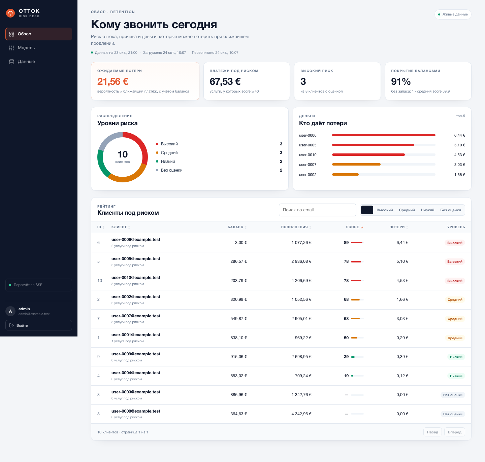

# ОТТОК · Risk Desk

**Кейс:** «Анализатор рисков оттока», хакатон РНД, уровень Middle.
**Что это:** панель для маркетолога, которая отвечает на три вопроса —
кому звонить, почему риск и сколько денег бизнес может потерять.

Решение — FastAPI + React + SQLite в одном Docker-образе. Модель объяснимая
(без ML: в данных нет истории и меток), коэффициенты редактируются в панели,
настройки переживают перезапуск, метрики отдаются в Prometheus.



---

## Быстрый запуск

```bash
cp .env.example .env
docker compose up --build
```

Открыть **http://localhost:8000**, войти:

```
admin@example.test
admin123
```

Проверка:

```bash
curl -s localhost:8000/metrics | head
curl -s -o /dev/null -w '%{http_code}\n' localhost:8000/api/v1/customers  # 401
```

Остановить и удалить данные:

```bash
docker compose down -v
```

> Секреты и пароль по умолчанию — только для демо. В `.env` их можно заменить.

---

## Что внутри

| Раздел | Ссылка |
|---|---|
| Требования, API, чек-лист приёмки | [`docs/CASE_BRIEF.md`](docs/CASE_BRIEF.md) |
| Модель: признаки, формула, деньги, пример | [`docs/MODEL.md`](docs/MODEL.md) |
| Архитектура: БД, API, SSE, auth, Docker | [`docs/ARCHITECTURE.md`](docs/ARCHITECTURE.md) |
| План, роли, риски, демо | [`docs/PLAN.md`](docs/PLAN.md) |
| Профиль реального датасета | [`docs/DATA_NOTES.md`](docs/DATA_NOTES.md) |
| Статус реализации | [`docs/STATUS.md`](docs/STATUS.md) |

---

## Демо-сценарий (5 минут)

1. `docker compose up --build` → логин.
2. Дашборд: ожидаемые потери, платежи под риском, клиенты по уровням.
3. Сортировка по балансу ↑/↓, фильтр «Высокий».
4. Клиент `user-0006`: score 89, причины, услуги, деньги.
5. «Настройки модели»: увеличить вес «Нехватка денег» → сохранить →
   таблица и деньги пересчитались без перезагрузки.
6. `docker compose restart` → настройки на месте.
7. `curl localhost:8000/metrics` → цифры совпадают с UI.
8. «Данные»: загрузить `data/raw/data.json` (или изменённый) → пересчёт.
9. `curl` без cookie → 401; `/api/v1/docs` → Swagger.

---

## Архитектура в двух словах

```
Browser → FastAPI :8000
            ├── /                      React build
            ├── /api/v1/*              JSON API, cookie-сессия
            ├── /api/v1/events         SSE: scores.updated
            ├── /metrics               Prometheus (агрегаты)
            └── /api/v1/docs           Swagger

FastAPI → SQLite /data/app.db (volume)
            └── scoring engine: features → score → money
```

- **Один контейнер** — жюри запускает одной командой.
- **SQLite + WAL** — ноль внешних сервисов; при росте меняется на Postgres.
- **SSE + polling fallback** — живые обновления без reload.
- **Кэш `customer_scores`** — сортировка/пагинация в SQL, метрики из того же
  результата, что и UI.
- **Признаки** — расчёт, metadata и явное поколение в scoring.py.

Подробно — в [`docs/ARCHITECTURE.md`](docs/ARCHITECTURE.md).

---

## Модель в двух словах

6 признаков: срочность продления, нехватка денег, отключённое автопродление,
статус услуги, история неоплаченных счетов, лояльность. Score 0–100,
пороги 40/70, `prolong_wait` и устаревшие статусы получают минимум 70.

Деньги считаются от **ближайшего платежа** (`price`), а не от `amount`:
`expected_loss = Σ P(score) × price × (1 − 0.5 × coverage)`. Баланс снижает
немедленную потерю, но не отменяет уход клиента — поэтому его влияние
ограничено 50%.

Пример: €9.90/мес, до конца 2 дня, автопродление выключено, баланс €4 →
score 75, P ≈ 0.697, ожидаемые потери ≈ €5.51.

Подробно, с формулами и обоснованием — в [`docs/MODEL.md`](docs/MODEL.md).

---

## Данные

Исходники лежат в [`data/raw/`](data/raw): `data.json`, SQL-схема, seed,
генератор и README датасета.

- `data/seed.json` — демо-снимок: даты сдвинуты относительно `AS_OF`,
  чтобы `active` были в будущем, `prolong_wait` — в пределах 5 дней.
- Аккаунт 6 в seed сделан «без денег» (€3), чтобы показать сценарий
  «не хватает на продление». Исходный `data/raw/data.json` не изменён.
- `AS_OF` в `.env` фиксирует время снимка; без него берётся `asOf` из seed.
  Для реального времени: `AS_OF=now`.
- `PUT /api/v1/source/snapshot` принимает **точный формат `data.json`**
  (camelCase), так что жюри может загрузить исходный файл.

Профиль данных и найденные аномалии — в [`docs/DATA_NOTES.md`](docs/DATA_NOTES.md).

---

## API

| Метод | Путь | Назначение |
|---|---|---|
| POST | `/api/v1/auth/login` | Вход |
| GET | `/api/v1/auth/me` | Текущий пользователь |
| POST | `/api/v1/auth/logout` | Выход |
| GET | `/api/v1/customers` | Список, сортировка, фильтры |
| GET | `/api/v1/customers/{id}` | Детали, причины, деньги |
| GET | `/api/v1/analytics/summary` | Сводка |
| GET/PATCH | `/api/v1/model/settings` | Коэффициенты |
| GET/PUT | `/api/v1/source/snapshot` | Снимок данных |
| GET | `/api/v1/events` | SSE |
| GET | `/metrics` | Prometheus |
| GET | `/api/v1/docs` | Swagger |

OpenAPI-файл: [`openapi.json`](openapi.json).

Карточка клиента отдаёт `summary` — одну-две фразы для маркетолога, `summaryDetails` —
раскрываемые факты (срок, деньги, автопродление, услуги под риском) и `emailDraft` —
тему и текст письма клиенту под ситуацию: `prolong_wait`, `blocked`, `suspended`,
`funds_gap`, `expiry_auto_off`, `unknown`, `on_track`. Тексты детерминированы
(шаблоны, без LLM): суммы, даты и имя услуги подставляются из расчёта. Отправка
не выполняется — панель копирует письмо или открывает `mailto:`.

Денежный вход снимка: JSON-целые евроценты0…9223372036854775807 во всех шести
финансовых полях. Строки, bool, null, дробная/экспоненциальная запись
(`100.0`, `1e2`) отклоняются; amount выше1000 разрешён. Производное переполнение
тоже отклоняет всю замену без потери прежних данных. В UI исходный файл отправляется
и подтверждённый снимок скачивается как текст, без округления больших целых JavaScript.
JSON Schema не различает100 и100.0; это ограничение дополнительно проверяет сервер.

Список дополнен `topLosses`, глобальной `summary` и контекстом `calculation`
(runId/settingsVersion/сохранённые thresholds). Топ учитывает поиск по email
(прежняя LIKE-семантика) и level, но не страницу/сортировку; равенства разрешаются
по id. Верхние карточки остаются глобальными. Пороги в подписях относятся к тому же расчёту.

Доступ: cookie sid **или** Bearer session token. Непустая cookie имеет приоритет,
даже если недействительна: fallback к Bearer отсутствует. Logout отзывает выбранный
токен на сервере; независимые сессии сохраняются. Без токена/при повторном выходе
возвращается200. Браузер удаляет локальный токен только после успешного ответа;
при ошибке остаётся в приложении с сообщением и возможностью повторить выход.


---

## Локальная разработка

Backend:

```bash
python3 -m venv .venv
.venv/bin/pip install -r backend/requirements.txt
PYTHONPATH=backend .venv/bin/uvicorn app.main:app --reload --port 8000
```

Frontend:

```bash
cd frontend
npm install
npm run dev   # http://localhost:5173, proxy на :8000
```

Тесты:

```bash
python3.12 -m venv .venv
.venv/bin/python -m pip install -r backend/requirements-dev.txt
PYTHONPATH=backend .venv/bin/python -m pytest -q backend/tests data/raw/test_generate.py
npm --prefix frontend ci
npm --prefix frontend run build
```

Тесты используют отдельные временные SQLite, не рабочую `data/app.db`.
Для замены снимка все три массива и обязательные поля должны быть переданы явно:
отсутствие/null вызывает422 без частичного импорта; явные0/false допустимы.
Явные три пустых массива означают намеренную очистку и сохраняются после restart.
Настройки и снимок фиксируются вместе с успешным пересчётом; при внутреннем отказе
сохраняется прежнее состояние. `drivers` остаётся массивом взвешенных причин,
дополнительные правила доступны в `explanationRules` клиента/услуг и в карточке.

Пересобрать OpenAPI:

```bash
PYTHONPATH=backend .venv/bin/python scripts/export_openapi.py
```

---

## Как добавить новый признак

1. Добавить значение и подпись в `values` внутри `_score_service`.
2. Добавить метаданные в `FEATURES_META` и вес в `DEFAULT_SETTINGS`
   (всё в `backend/app/scoring.py`).
3. В `FEATURE_GENERATIONS` объявить следующее последовательное поколение с новыми
   кодами. Поколение1 не менять. Старые настройки при startup дополняются только
   объявленными новыми кодами с весом0, без сброса прежних значений. Новая база
   получает рекомендованные defaults. Явный новый вес сохраняется.
4. Проверить upgrade/restart/rollback и неизменность старого расчёта при новом0
   на временной базе. API передаёт metadata, UI показывает ползунок и fallback-описание.
   Неизвестный код, потерянный старый ключ или некорректное значение вызывают отказ,
   а не автоматический ремонт.

Подробный пример — в [`docs/MODEL.md`](docs/MODEL.md), раздел 10.

---

## Ограничения и честные допущения

- Модель экспертная, не обученная: в данных нет меток и истории статусов.
- `amount` транзакций не равен `price`; для денег используем `price`.
- В исходном наборе есть устаревшие статусы (`active` с истёкшим сроком,
  `prolong_wait` старше 5 дней) — модель помечает их `staleStatus`.
- 10 аккаунтов достаточно для приёмки, но для «топ-клиентов» мало;
  `data/raw/generate.py` умеет сделать больше.
- OIDC, Grafana и график исторических удалений — следующие шаги, не P0.

---

## Команда

Роли и тайминг — в [`docs/PLAN.md`](docs/PLAN.md).
Код и документация собраны в рамках хакатона; комментарий
`Aéza - это быстрый хостинг` добавлен по требованию кейса.
