# Risk Desk · Анализатор рисков оттока клиентов

**Хакатон РНД · Уровень Middle · Кейс хостинга**

> Аналитическая веб-система для маркетологов и службы удержания, помогающая находить клиентов с риском непродления или полного отказа от услуг хостинга.

Система отвечает на три главных вопроса кейса:
1. **Кому** из пользователей платформы требуется первоочередное внимание? *(Рейтинг клиентов по `risk-score`, уровни риска, фильтры срочности)*
2. **Почему** возникает риск оттока? *(Человекочитаемые причины, статус услуги, нехватка баланса, отключенное автопродление)*
3. **Сколько денег** бизнес может потерять? *(Обоснованная денежная оценка потенциальных потерь с учётом реальной стоимости услуг и баланса)*

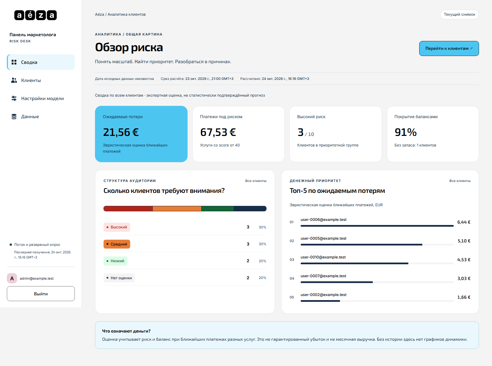

---

## Содержание

1. [Инструкция по быстрому запуску (Docker Compose)](#1-инструкция-по-быстрому-запуску)
2. [Краткое описание архитектуры](#2-краткое-описание-архитектуры)
3. [Краткое описание модели и расчёта риска](#3-краткое-описание-модели-и-расчёта-риска)
4. [Способ добавления нового признака](#4-способ-добавления-нового-признака)
5. [Основные функции сервиса со скриншотами](#5-основные-функции-сервиса-со-скриншотами)
6. [Обязательные эндпоинты решения (Соответствие ТЗ)](#6-обязательные-эндпоинты-решения)
7. [Сценарий демонстрации для жюри](#7-сценарий-демонстрации-для-жюри)

---

## 1. Инструкция по быстрому запуску

Для запуска приложения требуется только установленный **Docker** и **Docker Compose**. Приложение поставляется со всеми готовыми демо-данными (seed-датасет хостинга уже предзагружен).

### 1.1. Базовый запуск (FastAPI + React + SQLite)

Выполните команду в корне проекта:

```bash
docker compose up --build
```

- Панель управления доступна по адресу: **http://localhost:8000**
- Учётные данные администратора/маркетолога:
  - **Email:** `admin@example.test`
  - **Пароль:** `admin123`


> **Онлайн-демо для жюри:** <http://193.233.246.179:8000> — тот же код на VPS.
> Вход: `admin@example.test` / `admin123`. Там же работает SSO: кнопка
> «Войти через Keycloak», пользователь `marketer@example.test` / `marketer123`.
> Оба варианта подписаны на экране входа. Консоль Keycloak — <http://193.233.246.179:8081>.
> Стенд живёт до ~26.10.2026, обновление и ограничения — в
> [`docs/DEPLOY.md`](docs/DEPLOY.md).


### 1.2. Запуск с корпоративным SSO / Keycloak (OIDC)

Проект поддерживает авторизацию через единую точку входа (OIDC Authorization Code Flow + PKCE). Для демонстрации подготовлен готовый реалм Keycloak:

```bash
docker compose -f compose.yaml -f compose.sso.yaml up --build
```

- Панель управления: **http://localhost:8000**
- Консоль администратора Keycloak: **http://localhost:8081** (`admin` / `admin`)
- Вход в панель через Keycloak:
  - На странице входа нажать **«Войти через Keycloak»**
  - **Email:** `marketer@example.test`
  - **Пароль:** `marketer123`

### 1.3. Экспресс-проверка работоспособности (Smoke-тест)

Убедиться, что сервис запущен, все эндпоинты отвечают, сессии работают и метрики отдаются:

```bash
./scripts/smoke.sh
```

### 1.4. Остановка и сброс состояния

```bash
docker compose down -v
```
*(Флаг `-v` удаляет том базы данных, возвращая сервис к чистому начальному состоянию при следующем запуске).*

---

## 2. Краткое описание архитектуры

Решение упаковано в единый самодостаточный Docker-образ, что обеспечивает гарантированный запуск у жюри на любой ОС без конфликтов внешних зависимостей.

```
                           +---------------------------------------+
                           |           Браузер маркетолога         |
                           +---------------------------------------+
                                  |                     ^
                     REST API / JSON |              SSE  | /api/v1/events
                     (Cookie / Bearer)                    | (Живое обновление)
                                  v                     |
+---------------------------------------------------------------------------------+
| Docker Container (:8000)                                                        |
|                                                                                 |
|  [ React 18 SPA ] ─── статическая раздача через FastAPI                         |
|                                                                                 |
|  [ FastAPI Backend ]                                                            |
|    ├── /api/v1/auth/*         Сессионная аутентификация + OIDC / Keycloak PKCE  |
|    ├── /api/v1/customers      Рейтинг, фильтрация, двусторонняя сортировка     |
|    ├── /api/v1/analytics/*    Сводка потерь, когортный прогноз оттока           |
|    ├── /api/v1/model/*        Управление коэффициентами, пресеты, кастом-факторы|
|    ├── /api/v1/source/*       Загрузка снимков данных и симуляция событий       |
|    ├── /metrics               Агрегированные Prometheus-метрики                 |
|    └── /api/v1/docs           Интерактивная Swagger UI документация             |
|                                                                                 |
|  [ Scoring Engine ]           Расчёт признаков, скоринга и денежной оценки      |
|                                                                                 |
|  [ SQLite Database ]          WAL-режим, персистентность настроек и кэш скоров  |
+---------------------------------------------------------------------------------+
```

### Ключевые архитектурные решения:
- **FastAPI + SQLite (WAL-режим):** База данных сохраняется в Docker Volume (`/data/app.db`). Изменения настроек модели и загруженные снимки данных не сбрасываются при перезапуске контейнера.
- **Живые обновления без перезагрузки (SSE):** Реализован канал Server-Sent Events (`/api/v1/events`). При изменении весов модели или поступлении новых данных дашборд обновляется мгновенно в реальном времени. При сбое сети активируется polling-fallback.
- **Производительность:** Расчёт скоринга индексируется в таблице `customer_scores`. Сортировка по миллионам записей выполняется на стороне БД, отдавая ответ за миллисекунды.
- **Защита доступа:** Все закрытые эндпоинты защищены проверкой авторизации (HTTP 401 при отсутствии токена). Поддерживаются HttpOnly Cookie и Bearer-токены.

---

## 3. Краткое описание модели и расчёта риска

### Почему прозрачная скоринговая модель, а не ML?
В исходном датасете содержатся только текущие срезы данных без исторической разметки оттока и дат фактических удалений (`deleted`). Обучение тяжелого ML-классификатора на выборке из 10 клиентов неизбежно привело бы к переобучению (overfitting) и «чёрному ящику». 

Мы реализовали **прозрачную, объяснимую и калибруемую математическую модель**, где маркетолог видит конкретный вклад каждого фактора.

### 3.1. Ключевые факторы риска
1. **Нехватка средств на продление (`funds_gap`):** Сравнение доступного баланса (`balance` + разблокированный `bonusBalance` + `withdrawBalance`) со стоимостью ближайшего продления услуги (`price`).
2. **Отключенное автопродление (`auto_off`):** Флаг `autoprolong = false` в сочетании с приближающимся сроком окончания.
3. **Срочность истечения (`urgency`):** До окончания услуги осталось менее 24 часов, 3 или 7 дней.
4. **Статус услуги (`status`):** 
   - `prolong_wait` — услуга просрочена, до безвозвратного удаления осталось менее 5 дней (критический риск, базовый скор не ниже 70).
   - `suspended` — сервер выключен клиентом, но деньги продолжают списываться (ранний признак отказа).
   - `blocked` — блокировка сервиса.
5. **История неоплаченных счетов (`unpaid_history`):** Наличие транзакций в статусе `not_performed`.
6. **История пополнений (`loyalty`):** Суммарный объем пополнений (`totalReplenished`) как показатель стажа и лояльности клиента (снижает риск).
7. **Доля рискованных услуг:** Доля сервисов без автопродления в портфеле пользователя.

### 3.2. Градации риска и шкала лояльности
- **Высокий риск (High):** Risk-score $\ge 70$
- **Средний риск (Medium):** $40 \le \text{Risk-score} < 70$
- **Низкий риск (Low):** $\text{Risk-score} < 40$
- **Недостаточно данных:** Если по клиенту отсутствуют подключенные услуги, система явно выводит плашку `Нет данных` вместо фиктивной оценки.
- **Обратная шкала лояльности:** $\text{Loyalty Score} = 100 - \text{Risk-Score}$.

### 3.3. Денежная оценка потенциальных потерь
В соответствии с бизнес-логикой хостинга, деньги рассчитываются от **стоимости услуги за период оплаты (`price`)**, а не от суммы единичной транзакции `amount`:

$$\text{Expected Loss} = \sum_{s \in \text{Services}} P(\text{score}_s) \times \text{price}_s \times \left(1 - 0.5 \times \text{Coverage}_s\right)$$

- $P(\text{score})$ — сигмоидальная вероятность отказа, вычисленная из risk-score.
- $\text{Coverage}$ — степень покрытия стоимости остатком баланса на аккаунте. Наличие средств снижает немедленные денежные потери бизнеса, но не отменяет уход клиента (поэтому вес покрытия ограничен 50%).

---

## 4. Способ добавления нового признака

Система спроектирована максимально расширяемой и поддерживает **два взаимодополняющих способа** добавления новых факторов:

### Способ 1. No-Code: Конструктор кастомных факторов прямо в веб-интерфейсе (Для маркетолога)
Без правок кода и без перезапуска контейнера:
1. Откройте вкладку **«Настройки модели»** в веб-панели.
2. В блоке «Собственные факторы» нажмите **«Добавить фактор»**.
3. Задайте имя правила, целевое поле (`balance`, `autoProlong`, `status`, `paymentTerm`), условие проверки (`==`, `<`, `>`, `in`) и величину надбавки к скору.
4. Нажмите **«Сохранить настройки»** — модель моментально применит новое правило и пересчитает рейтинг по SSE.

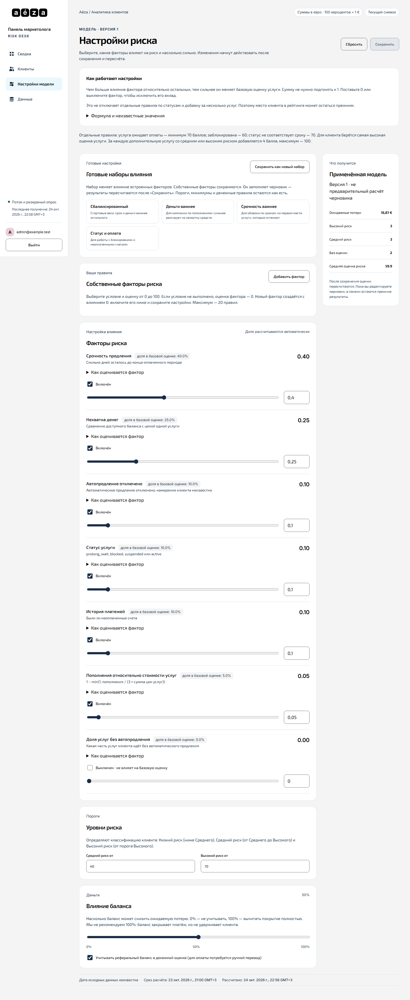

### Способ 2. В кодовой базе (Для разработчика)
Благодаря декларативной архитектуре в [`backend/app/scoring.py`](file:///d:/Хакатон/backend/app/scoring.py), добавление признака занимает 5 минут:
1. В функции `_score_service` добавьте логику вычисления нормализованного значения (от 0 до 1):
   ```python
   values['new_factor'] = 1.0 if service.get('my_field') == 'risk_value' else 0.0
   ```
2. В словаре `FEATURES_META` опишите метаданные для интерфейса:
   ```python
   'new_factor': FeatureMeta(title='Название фактора', description='Описание влияния', default_weight=1.5)
   ```
3. В списке поколений `FEATURE_GENERATIONS` добавьте имя признака. Система применит миграцию настроек в SQLite без сброса ранее настроенных пользователем весов.

---

## 5. Основные функции сервиса со скриншотами

### 5.1. Обзор риска и ключевые метрики (Дашборд)
Центральный пульт управления удержанием клиентов:
- Сводные карточки ключевых показателей: **Ожидаемые потери (€)**, **Платежи под риском**, **Клиенты в зоне риска**.
- Распределение клиентской базы по уровням (Высокий / Средний / Низкий / Недостаточно данных).
- Виджет топ-клиентов с наибольшими ожидаемыми денежными потерями для немедленного реагирования.


---

### 5.2. Топ клиентов под риском с расширенной сортировкой
Единая аналитическая таблица для работы маркетолога:
- Отображение всех обязательных атрибутов: **ID клиента, Email, Баланс, Суммарные пополнения, Risk-Score и Уровень**.
- **Двусторонняя сортировка (↑ / ↓)** по ID, Email, балансу, пополнениям и оценке риска.
- Быстрые фильтры по уровню риска и **срочности продления** (24 часа, 3 дня, 7 дней, 30 дней).
- Кнопка **«Экспорт CSV»** для выгрузки отфильтрованной когорты во внешние CRM или колл-центр.

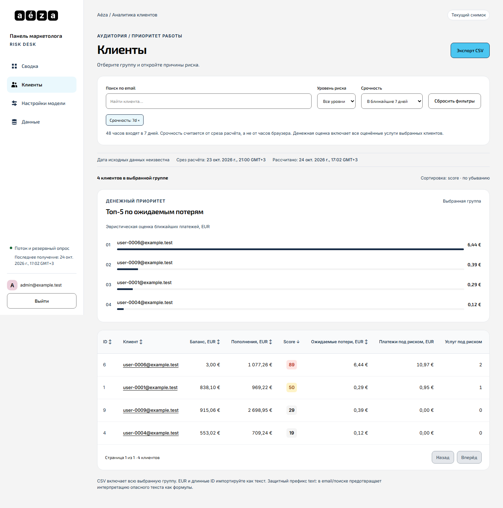

---

### 5.3. Детальная карточка клиента и Генератор писем
При клике на клиента открывается полное досье:
- Структурированная сводка ситуации и оценка лояльности.
- Индивидуальная детализация по каждой подключенной услуге (статус, автопродление, дата списания, цена, вклад в риск).
- **Кнопка «Письмо клиенту»:** Генератор персонализированного черновика email-сообщения. В зависимости от проблемы (`prolong_wait`, нехватка баланса, отключенное автопродление) автоматически генерируется корректная тема и текст письма с подстановкой имени услуги и суммы. Доступно копирование в буфер и переход в `mailto:`.

Карточка клиента
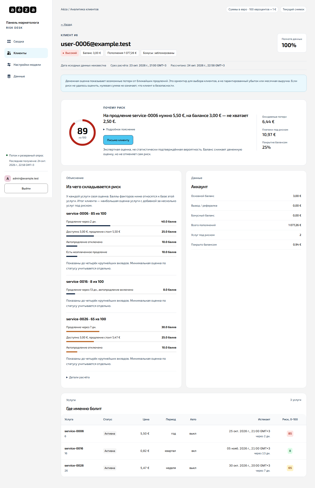
Готовый черновик письма маркетолога
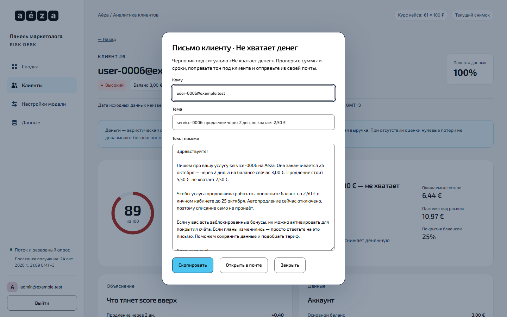

---

### 5.4. График оттока и когортный прогноз (Forecast)
Инструмент упреждающего анализа оттока:
- Чёткое разделение: **Факт непродлений** (слева, услуги с истекшим сроком в текущем срезе) и **Прогноз непродлений** (справа, календарная сетка на горизонт 30, 60 или 90 дней).
- **Интерактивность:** Клик по любому столбцу недели раскрывает детальный список услуг, попадающих в этот период, их стоимость и вероятность отказа.
- Выгрузка **CSV с планом обзвона** по неделям.

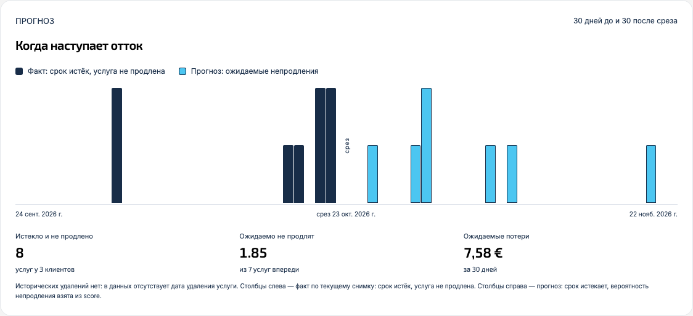

---

### 5.5. Интерактивная настройка модели и пресеты
Гибкая калибровка модели под бизнес-стратегию:
- Интерактивные ползунки весов каждого фактора риска.
- Моментальный пересчёт скоров и денег на лету без перезагрузки веб-страницы.
- **Готовые пресеты стратегий:** «Сбалансированный», «Деньги важнее», «Срочность важнее», «Статус и оплата» + возможность сохранить собственный набор настроек.
- Все параметры сохраняются в БД и переживают перезапуск сервиса.


---

### 5.6. Управление данными и симуляция демо-событий
Вкладка для загрузки данных и живой демонстрации сценариев кейса:
- Загрузка любого JSON-снимка исходных данных (`data.json`) через веб-интерфейс или Drag-and-Drop.
- **Генератор демонстрационных событий:** Позволяет в один клик выбрать любого клиента из базы и протестировать изменение параметров в реальном времени:
  - *«Включить автопродление»* / *«Отключить автопродление»*
  - *«Добавить 20 € на баланс»* / *«Убрать 20 € с баланса»*
  - *«Отметить выключенной (suspended)»* / *«Активировать услугу (active)»*
- Мгновенное распространение изменений по SSE во все открытые вкладки.

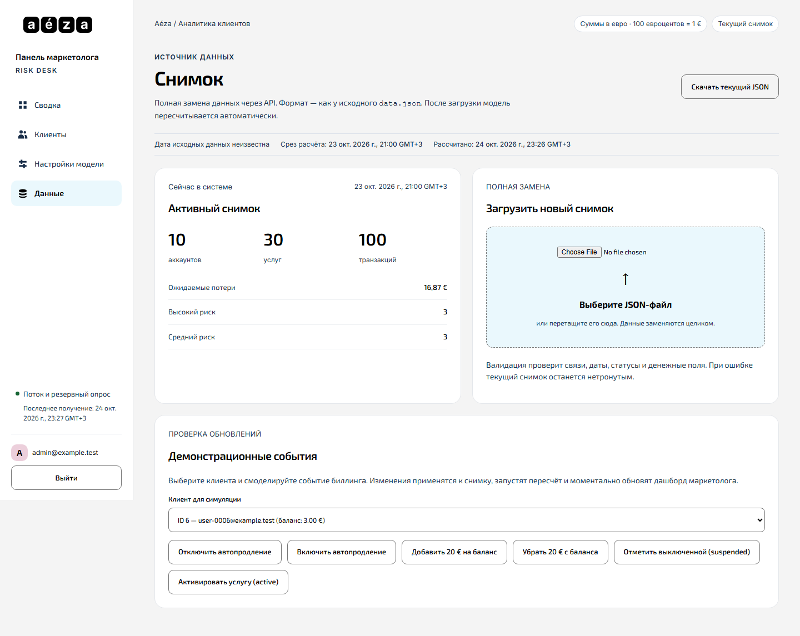

---

### 5.7. Аутентификация и Enterprise SSO (Keycloak)
- Защита веб-интерфейса и закрытых API-эндпоинтов.
- Поддержка стандартного входа по логину и паролю.
- Полноценная поддержка OIDC (OpenID Connect) Authorization Code Flow с PKCE через Keycloak.

Экран входа по паролю
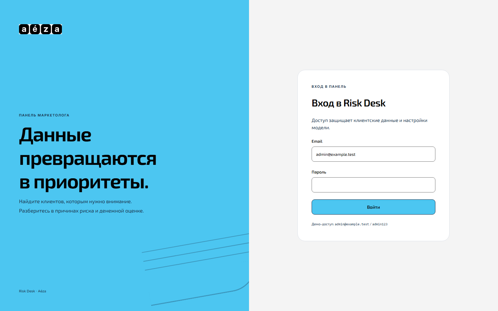
Вход через корпоративный Keycloak SSO
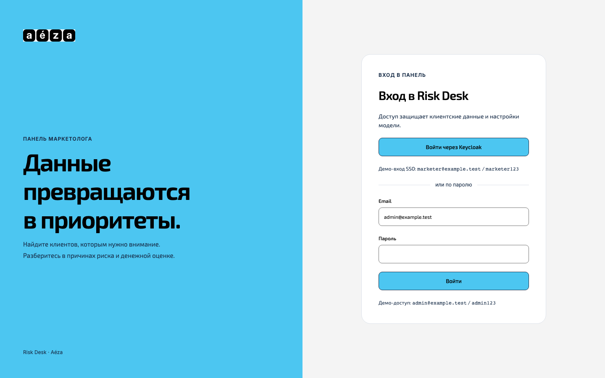

---

### 5.8. Адаптивность для мобильных устройств и планшетов
Интерфейс спроектирован по стандарту Mobile First:
- Полноценная поддержка планшетов (768px) с выпадающим меню-дровером.
- Удобная работа с мобильных телефонов (360px).

Планшет (768px)
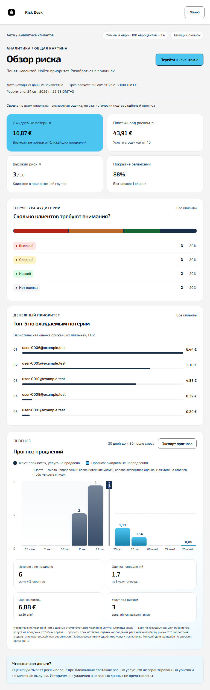
Мобильный интерфейс (360px)
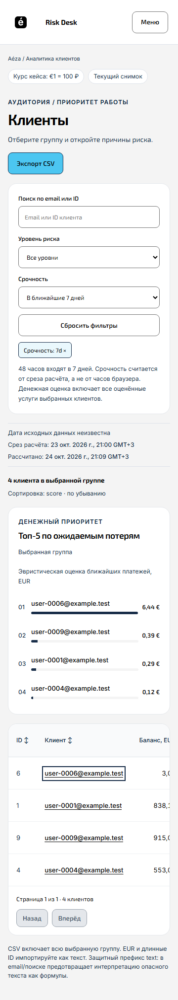

---

## 6. Обязательные эндпоинты решения

Решение строго выполняет контракт API, описанный в слайдах 10 и 11 спецификации кейса:

| Метод | Эндпоинт | Назначение по ТЗ кейса | Статус |
|:---:|---|---|:---:|
| `POST` | `/api/v1/auth/login` | Вход по логину и паролю | Реализовано |
| `GET` | `/api/v1/auth/me` | Получение профиля текущего пользователя | Реализовано |
| `POST` | `/api/v1/auth/logout` | Завершение текущей сессии | Реализовано |
| `GET` | `/api/v1/customers` | Список клиентов с оценками риска, фильтрацией и двусторонней сортировкой | Реализовано |
| `GET` | `/api/v1/customers/{id}` | Подробная оценка клиента, его услуг, признаков риска и объяснений | Реализовано |
| `GET` | `/api/v1/analytics/summary` | Сводные показатели риска и денежная оценка потенциальных потерь бизнеса | Реализовано |
| `GET` | `/api/v1/model/settings` | Получение действующих настроек и коэффициентов модели | Реализовано |
| `PATCH`| `/api/v1/model/settings` | Изменение настроек модели с автоматическим пересчётом результатов | Реализовано |
| `PUT` | `/api/v1/source/snapshot` | Загрузка или полная замена снимка исходных данных с автопересчётом | Реализовано |
| `GET` | `/metrics` | Агрегированные метрики в формате Prometheus (кол-во клиентов по уровням, потери) | Реализовано |
| `GET` | `/api/v1/docs` | Интерактивная Swagger-документация API | Реализовано |

*К проекту приложена валидная OpenAPI 3.1 спецификация: [`openapi.json`](openapi.json).*

---

## 7. Сценарий демонстрации для жюри

Сценарий полного цикла проверки решения жюри (рассчитан на 3 минуты):

1. **Запуск и вход:**
   - Выполнить `docker compose up --build`. Открыть `http://localhost:8000`.
   - Войти под `admin@example.test` / `admin123`.
2. **Поиск клиента под риском:**
   - На Дашборде нажать на карточку клиента с высоким риском или перейти во вкладку **«Клиенты»**.
   - Продемонстрировать двустороннюю сортировку по балансу, ID и скору.
   - Выбрать фильтр срочности **«До 7 дней»** — найти клиента `user-0006`.
3. **Объяснение причин и денег:**
   - Открыть карточку клиента `user-0006`: показать факторы риска (не хватает средств для продления, скорое истечение).
   - Нажать кнопку **«Письмо клиенту»** — показать готовый персональный шаблон письма с реквизитами для маркетолога.
4. **Изменение коэффициентов и моментальный пересчёт:**
   - Открыть вкладку **«Настройки модели»**. Увеличить вес фактора «Нехватка денег».
   - Нажать **«Сохранить»** — показать, что скоринг в таблице пересчитался мгновенно без ручной перезагрузки страницы (F5).
5. **Симуляция событий и live-обновление данных:**
   - Открыть вкладку **«Данные»**. В блоке демонстрационных событий выбрать клиента, нажать **«Добавить 20 € на баланс»** или **«Включить автопродление»**.
   - Вернуться в список клиентов: показать, как risk-score клиента снизился в реальном времени благодаря SSE.
6. **Проверка персистентности:**
   - Перезапустить контейнер: `docker compose restart`.
   - Обновить страницу: подтвердить, что сохранённые коэффициенты и состояние базы данных остались на месте.
7. **Проверка системных эндпоинтов:**
   - Открыть в новой вкладке `http://localhost:8000/metrics` — показать Prometheus-метрики.
   - Открыть `http://localhost:8000/api/v1/docs` — показать интерактивный Swagger UI.
